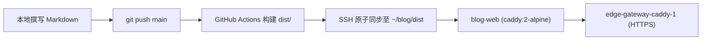

在只有 2 GiB 内存、同时还跑着 MySQL 和 Redis 的云服务器上部署个人博客，最核心的设计原则就是**把构建留在 CI/本地，把运行时压到最轻**。

## 为什么选择纯静态 + Caddy 容器

动态博客在每次请求时都需要进程常驻内存，而纯静态站点由 `caddy:2-alpine` 托管静态 HTML 与分片搜索索引，常驻内存通常不到 20 MB。



## 复杂度与构建性能对比

如果把全站页面数记为 $n$、单页索引构建耗时记为 $c$，静态站点在 CI 侧的构建开销近似满足：

$$
T(n) = O(n \log n) + c \cdot n
$$

而在服务端，每个请求的响应只涉及内存缓存或零拷贝文件发送，时间复杂度稳定在 $O(1)$。

### 关键配置示例

下面是接入现有网关网络时使用的容器配置片段：

```yaml
services:
  blog-web:
    image: caddy:2-alpine
    container_name: blog-web
    restart: unless-stopped
    mem_limit: 96m
    networks:
      - edge-gateway
```

### 前端按需加载策略

为了让首屏保持极简，搜索索引（Pagefind）和流程图引擎（Mermaid）都采用按需加载：

```ts
export async function loadMermaidWhenNeeded(hasDiagram: boolean) {
  if (!hasDiagram) return null;
  const mod = await import('https://cdn.jsdelivr.net/npm/mermaid@11/dist/mermaid.esm.min.mjs');
  return mod.default;
}
```

## 小结

把写作资产保留在纯文本 Markdown 里，既能享受版本控制带来的安全感，也能让小规格服务器长期稳定运行。
